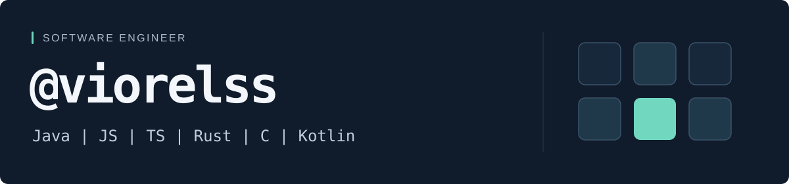

  

  <strong>I build web applications and tools that make everyday work easier.</strong> 
  Focused on Java and its ecosystem, with experience across frontend, backend, and Linux environments.

  <a href="#selected-projects">Selected projects</a> &nbsp;·&nbsp;
  <a href="#toolbox">Toolbox</a> &nbsp;·&nbsp;
  <a href="https://www.linkedin.com/in/viorelss/">LinkedIn ↗</a>

<h2>Selected projects</h2>

<table>
  <tr>
    <td valign="top">
      
      01 / DEVELOPER TOOLING
      <h3>Bottom Panel Toggle</h3>
      
A small IntelliJ IDEA plugin built around one shortcut: hide the bottom panel, then restore the last used tool window. Side panels stay visible.

      
<code>Kotlin</code> <code>IntelliJ Platform</code>

      

        <a href="https://github.com/ViorelsS/bottom-panel-toggle">Source code</a> &nbsp;·&nbsp;
        <a href="https://plugins.jetbrains.com/plugin/35398-bottom-panel-toggle">Marketplace ↗</a>
      

    </td>
  </tr>
  <tr>
    <td valign="top">
      
      02 / WEB APPLICATION
      <h3>JS_HackerNews</h3>
      
A responsive Hacker News reader built with vanilla JavaScript. Fetch the latest stories on demand and browse titles, authors, and links in a compact feed.

      
<code>JavaScript</code> <code>SCSS</code> <code>Webpack</code>

      

        <a href="https://github.com/ViorelsS/JS_HackerNews">Source code</a> &nbsp;·&nbsp;
        <a href="https://js-hackernews.netlify.app/">Live demo ↗</a>
      

    </td>
  </tr>
</table>

<h2>Toolbox</h2>

<table>
  <tr>
    <th width="25%" align="left">Backend &amp; data</th>
    <td>
      <code>Java</code> <code>Node.js</code> <code>SQL</code> <code>Hibernate</code>
    </td>
  </tr>
  <tr>
    <th align="left">Frontend &amp; mobile</th>
    <td>
      <code>JavaScript</code> <code>TypeScript</code> <code>React</code> <code>React Native</code>
    </td>
  </tr>
  <tr>
    <th align="left">Tools &amp; workflow</th>
    <td>
      <code>Linux</code> <code>Git</code> <code>Docker</code> <code>Bash</code> <code>Python</code> <code>CI/CD</code>
    </td>
  </tr>
</table>

 

  <strong>Let’s connect.</strong> 
  Find me on <a href="https://www.linkedin.com/in/viorelss/">LinkedIn ↗</a>.

